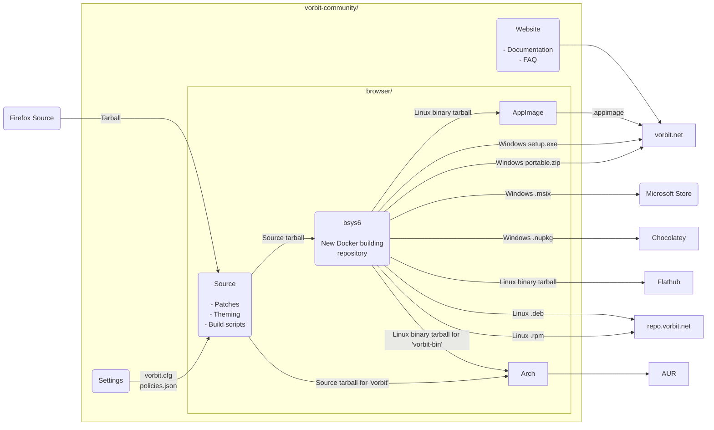

# vOrbit Lite Source

This repository contains the vOrbit Lite patches, branding, and build scripts. The settings submodule pins the [upstream LibreWolf settings](https://codeberg.org/librewolf/settings). Source preparation adapts those settings for vOrbit Lite.

## vorbit overview



## Active repositories and projects

List of browser build sub projects. These are the locations where people have their repositories and build artifacts.

Currently active build repositories:

* [Arch](https://codeberg.org/vorbit/arch): Arch Linux package
* [Bsys6](https://codeberg.org/vorbit/bsys6): .deb/.rpm for Mint, Fedora, Ubuntu; .dmg for MacOS; portable/setup for Windows.
* [Gentoo](https://codeberg.org/vorbit/gentoo): Gentoo package

Downstream distribution packages:

* [Alpine Linux aport](https://pkgs.alpinelinux.org/packages?name=vorbit&arch=)

Previous forks:

* Cachy-Browser: https://github.com/cachyos/cachyos-browser-settings
* FireDragon: https://github.com/dr460nf1r3/firedragon-browser

## vorbit build instructions

There are two ways to build vorbit. You can either use the source tarball or compile directly with this repository.

### Building from the Tarball

The [Releases page](https://github.com/vishwakarmaindustriesabhishek-in/vOrbit-litefox/releases) is the download location for the prepared source tree and its SHA-256 checksum.

```bash
tar xf <tarball>
cd <folder>
```

Then, you have to bootstrap your system to be able to build vorbit. You only have to do this one time. It is done by running the following commands:

```bash
./mach --no-interactive bootstrap --application-choice=browser
```

Finally you can build vorbit and then package or run it with the following commands:

```bash
./mach build
./mach package
# OR
./mach run
```

### Building with this Repository

First, clone this repository with Git:

```bash
git clone --recursive https://github.com/vishwakarmaindustriesabhishek-in/vOrbit-litefox.git vorbit-source
cd vorbit-source
```

Next, build the vorbit source code with the following command:

```bash
make dir
```

After that, you have to bootstrap your system to be able to build vorbit. You only have to do this one time. It is done by running the following command:

```bash
make bootstrap
```

Finally you can build vorbit and then package or run it with the following commands:

```bash
make build
make package
# OR
make run
```

## Translations

We use Weblate to localize all vorbit-specific strings. You can help us by
translating vorbit into your language at
https://translate.codeberg.org/engage/vorbit. Here is the current translation
status:

<a href="https://translate.codeberg.org/engage/vorbit/">

</a>

## Development Notes

### How to make a patch

The easiest way to make patches is to go to the vorbit source folder:
```bash
cd vorbit-$(cat version)
git init
git add <path_to_file_you_changed>
git commit -am initial-commit
git diff > ../mypatch.patch
```
We have Gitter / Matrix rooms, and on the website we have links to the various issue trackers.

### How to work on an existing patch

The easiest way to make patches is to go to the vorbit source folder:
```bash
make fetch # get the firefox tarball
./scripts/git-patchtree.sh patches/sed-patches/disable-pocket.patch
```
Now change the source tree the way you want, keeping in mind to `git add` new files. When done, you can create the new patch with:
```bash
cd firefox-<version>
git diff 4b825dc642cb6eb9a060e54bf8d69288fbee4904 HEAD > ../my-patch-name.patch
```
This ID is the hash value of the first commit, which is called `initial`. Dont forget to commit changes before doing this diff, or the patch will be incomplete.


### How to create a patch for problems in Mozilla's [Bugzilla](https://bugzilla.mozilla.org/).

Well, first of all:

* [Create an account](https://bugzilla.mozilla.org/createaccount.cgi).
* Handy link: [Bugs Filed Today](https://bugzilla.mozilla.org/buglist.cgi?cmdtype=dorem&remaction=run&namedcmd=Bugs%20Filed%20Today&sharer_id=1&list_id=15939480).
* The essential: [Firefox Source Tree Documentation](https://firefox-source-docs.mozilla.org/).

Now that you have a patch in vorbit, that's not enough to upload to Mozilla. See, Mozilla only accepts patches against Nightly. So here is how to do that:

If you have not done already, create the `mozilla-unified` folder and build Firefox with it:
```bash
hg clone https://hg.mozilla.org/mozilla-unified
cd mozilla-unified
hg update
MOZBUILD_STATE_PATH=$HOME/.mozbuild ./mach --no-interactive bootstrap --application-choice=browser
./mach build
./mach run
```
If you skipped the previous step, you could ensure that you're up to date with:
```bash
cd mozilla-unified
hg pull
hg update
```
Now you can apply your patch to Nightly:
```bash
patch -p1 -i ../mypatch.patch
```
Now you let Mercurial create the patch:
```bash
hg diff > ../my-nightly-patch.patch
```
And it can be uploaded to Bugzilla.

##### *(excerpt from the Mozilla readme)* Now the fun starts

Time to start hacking! You should join us on [Matrix](https://chat.mozilla.org/), say hello in the [Introduction channel](https://chat.mozilla.org/#/room/#introduction:mozilla.org), and [find a bug to start working on](https://codetribute.mozilla.org/). See the [Firefox Contributors’ Quick Reference](https://firefox-source-docs.mozilla.org/contributing/contribution_quickref.html#firefox-contributors-quick-reference) to learn how to test your changes, send patches to Mozilla, update your source code locally, and more.

## Hey, I'm using MacOS or Windows..
We understand, life isn't always fair 😺. The same steps as above do apply, you'll just have to walk through the beginning part of the guides for:
* [MacOS](https://firefox-source-docs.mozilla.org/setup/macos_build.html): The cross-compiled Mac .dmg files are somewhat new. They should work, perhaps with the exception of the `make setup-wasi` step.
* [Windows](https://firefox-source-docs.mozilla.org/setup/windows_build.html): Building on Windows is not very well tested.

Help with testing these targets is always welcome.
